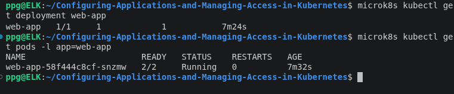
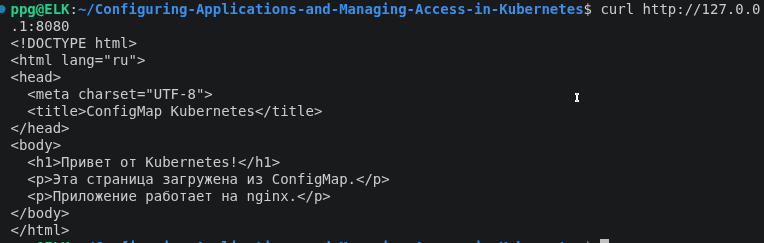
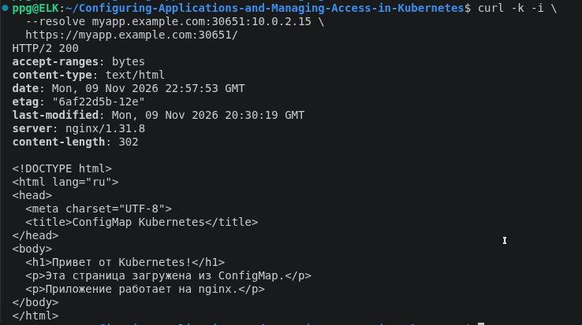
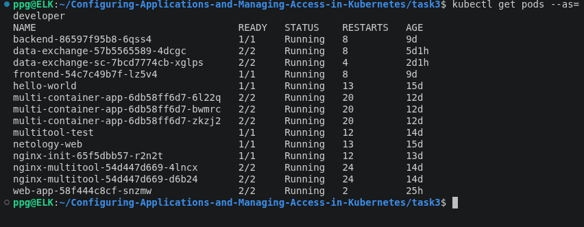

# Домашнее задание к занятию «Настройка приложений и управление доступом в Kubernetes» - Петр Петров
## **Задание 1: Работа с ConfigMaps**
### **Задача**
Развернуть приложение (nginx + multitool), решить проблему конфигурации через ConfigMap и подключить веб-страницу.

### **Шаги выполнения**
1. **Создать Deployment** с двумя контейнерами
   - `nginx`
   - `multitool`
3. **Подключить веб-страницу** через ConfigMap
4. **Проверить доступность**

### **Что сдать на проверку**
- Манифесты:
  - `deployment.yaml`
  - `configmap-web.yaml`
- Скриншот вывода `curl` или браузера

---

### Решение

### Манифесты

[deployment.yaml](task1/deployment.yaml)

[configmap-web.yaml](task1/configmap-web.yaml)

Оба контейнера успешно запущены.



Проверка веб-страницы

`curl http://127.0.0.1:8080`



## **Задание 2: Настройка HTTPS с Secrets**  
### **Задача**  
Развернуть приложение с доступом по HTTPS, используя самоподписанный сертификат.

### **Шаги выполнения**  
1. **Сгенерировать SSL-сертификат**
```bash
openssl req -x509 -nodes -days 365 -newkey rsa:2048 \
  -keyout tls.key -out tls.crt -subj "/CN=myapp.example.com"
```
2. **Создать Secret**
3. **Настроить Ingress**
4. **Проверить HTTPS-доступ**

### **Что сдать на проверку**  
- Манифесты:
  - `secret-tls.yaml`
  - `ingress-tls.yaml`
- Скриншот вывода `curl -k`

---

### Решение

### Манифесты

[service-web.yaml](task2/service-web.yaml) — Service типа ClusterIP.

[ingress-tls.yaml](task2/ingress-tls.yaml) — Ingress с настройкой HTTPS.

[secret-tls.example.yaml](task2/secret-tls.example.yaml) — шаблон TLS Secret.

Проверка HTTPS-доступа: успешный ответ HTTP/2 200 и HTML-содержимое страницы




## **Задание 3: Настройка RBAC**  
### **Задача**  
Создать пользователя с ограниченными правами (только просмотр логов и описания подов).

### **Шаги выполнения**  
1. **Включите RBAC в microk8s**
```bash
microk8s enable rbac
```
2. **Создать SSL-сертификат для пользователя**
```bash
openssl genrsa -out developer.key 2048
openssl req -new -key developer.key -out developer.csr -subj "/CN={ИМЯ ПОЛЬЗОВАТЕЛЯ}"
openssl x509 -req -in developer.csr -CA {CA серт вашего кластера} -CAkey {CA ключ вашего кластера} -CAcreateserial -out developer.crt -days 365
```
3. **Создать Role (только просмотр логов и описания подов) и RoleBinding**
4. **Проверить доступ**

### **Что сдать на проверку**  
- Манифесты:
  - `role-pod-reader.yaml`
  - `rolebinding-developer.yaml`
- Команды генерации сертификатов
- Скриншот проверки прав (`kubectl get pods --as=developer`)

### Решение

Манифесты: 

[role-pod-reader.yaml](task3/role-pod-reader.yaml)

[rolebinding-developer.yaml](task3/rolebinding-developer.yaml)

### Создание сертификата пользователя

Создаём закрытый ключ:

`openssl genrsa -out developer.key 2048`

Создаём запрос на сертификат (CSR):

``` 
openssl req -new \
  -key developer.key \
  -out developer.csr \
  -subj "/CN=developer"
```

Подписываем сертификат центром сертификации MicroK8s:

```
sudo openssl x509 -req \
  -in developer.csr \
  -CA /var/snap/microk8s/current/certs/ca.crt \
  -CAkey /var/snap/microk8s/current/certs/ca.key \
  -CAcreateserial \
  -out developer.crt \
  -days 365
```

### Настройка kubeconfig пользователя

Создаём отдельную конфигурацию для пользователя developer, используя сертификат, закрытый ключ и CA-сертификат MicroK8s.

```
microk8s kubectl config set-cluster microk8s-cluster \
  --server=https://10.0.2.15:16443 \
  --certificate-authority=/var/snap/microk8s/current/certs/ca.crt \
  --embed-certs=true \
  --kubeconfig=developer.kubeconfig

```
```
microk8s kubectl config set-credentials developer \
  --client-certificate=developer.crt \
  --client-key=developer.key \
  --embed-certs=true \
  --kubeconfig=developer.kubeconfig
```
```
microk8s kubectl config set-credentials developer \
  --client-certificate=developer.crt \
  --client-key=developer.key \
  --embed-certs=true \
  --kubeconfig=developer.kubeconfig

microk8s kubectl config set-context developer-context \
  --cluster=microk8s-cluster \
  --user=developer \
  --namespace=default \
  --kubeconfig=developer.kubeconfig
```

```
microk8s kubectl config use-context developer-context \
  --kubeconfig=developer.kubeconfig
```


